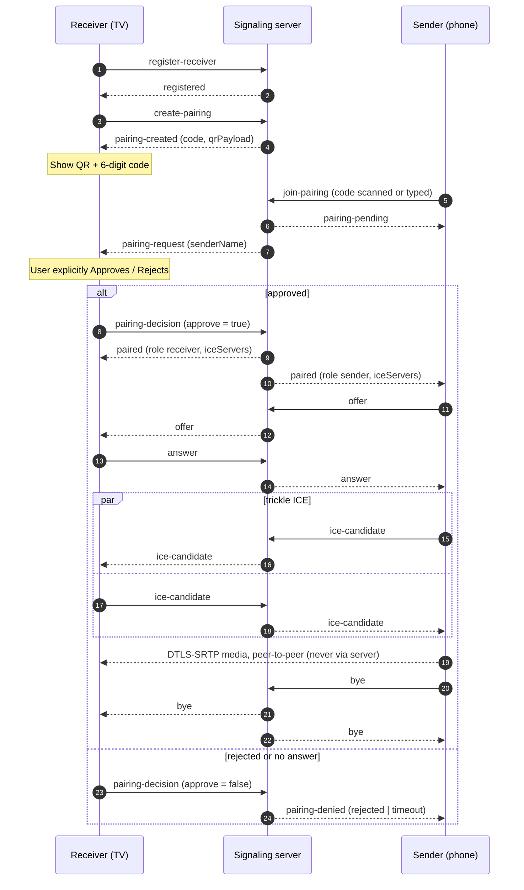
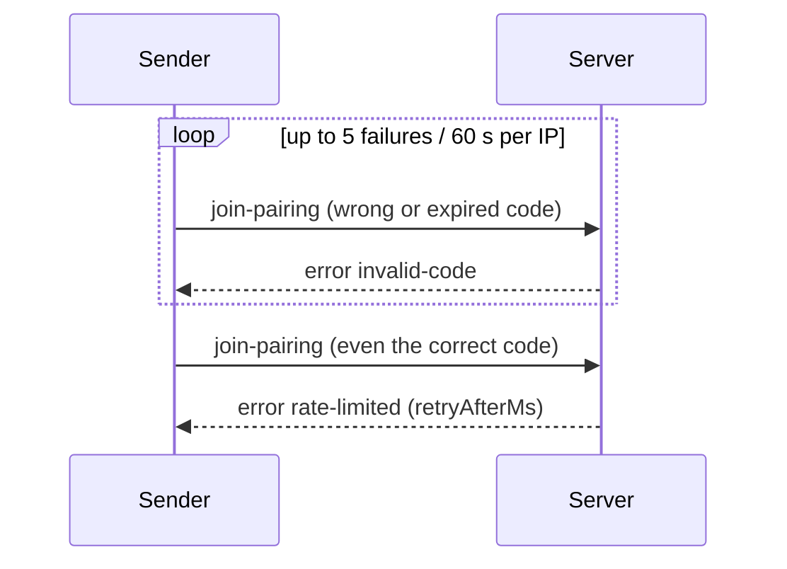

# Signaling protocol v1

Transport: WebSocket text frames, one JSON object per frame, endpoint `/ws`.
`wss://` in production; `ws://` only when the server runs with `ALLOW_INSECURE_WS=true` (LAN mode).
Binary frames are rejected (close 1003). Frames over `MAX_PAYLOAD_BYTES` (default 64 KiB) close the socket (1009).
All client messages are validated with strict Zod schemas: unknown keys, wrong types or malformed values yield `invalid-message`.
Five invalid messages on one connection close it (1008).

Every client message may carry an optional `id` (≤ 64 chars). Direct replies (`registered`, `pairing-created`,
`pairing-pending`, `ice-servers`, `pong`, `error`) echo it. Asynchronous events (`pairing-request`, `paired`, relayed
SDP/ICE, `bye`, …) do not.

The server never sees media. It relays `offer` / `answer` / `ice-candidate` between the two paired peers and nothing else.

## Roles and states

| Role | How obtained | Notes |
|---|---|---|
| receiver (TV) | `register-receiver` | Owns at most one live code at a time. |
| sender (phone) | `join-pairing` with a valid code | Anonymous until it joins. |

A receiver is *idle* → *awaiting approval* (after a sender joined) → *in session*; it returns to idle on `bye` or when the peer leaves.
A sender is *none* → *awaiting approval* → *in session*; it returns to *none* afterwards and may join again with a new code.

## Message reference

### Client → server

| `type` | Fields | Allowed when |
|---|---|---|
| `register-receiver` | `deviceName` (1–64, no control chars), `protocolVersion` (=1) | fresh connection |
| `create-pairing` | – | receiver, idle |
| `join-pairing` | `code` (`^\d{6}$`), `deviceName`, `protocolVersion` | fresh connection |
| `pairing-decision` | `pairingId` (uuid), `approve` (bool) | receiver, awaiting approval |
| `offer` | `sdp` (≤ 60 000 chars) | **sender only**, in session |
| `answer` | `sdp` | **receiver only**, in session |
| `ice-candidate` | `candidate` (≤ 2000; `""` = end-of-candidates), `sdpMid?`, `sdpMLineIndex?` | in session |
| `get-ice-servers` | – | in session (fresh TURN credentials, e.g. before an ICE restart) |
| `bye` | `reason?` (≤ 64) | any; ends session / cancels pending / withdraws the unused code |
| `ping` | `ts?` | any |

### Server → client

| `type` | Fields | Sent to |
|---|---|---|
| `registered` | `receiverId`, `serverTime`, `protocolVersion` | receiver |
| `pairing-created` | `pairingId`, `code`, `expiresAt` (ms epoch), `ttlSeconds`, `qrPayload` (string or `null`) | receiver |
| `pairing-expired` | `pairingId` | receiver (code unused after TTL) |
| `pairing-pending` | `pairingId`, `approvalTimeoutMs` | sender |
| `pairing-request` | `pairingId`, `senderName`, `approvalTimeoutMs` | receiver – show Approve / Reject |
| `pairing-denied` | `pairingId`, `reason`: `rejected` \| `timeout` \| `receiver-gone` | sender (also receiver on `timeout`) |
| `paired` | `sessionId`, `role`, `peerName`, `iceServers[]` | both |
| `ice-servers` | `iceServers[]` | requester |
| `offer` / `answer` / `ice-candidate` | as above | the other peer |
| `bye` | `reason` | both peers when a session ends (initiator included); also receiver on sender cancel |
| `pong` | `ts?`, `serverTime` | requester |
| `error` | `code`, `message`, `retryAfterMs?` | requester |

`bye.reason` values the server generates: `peer-disconnected`, `cancelled`, `server-shutdown`. Otherwise it is the peer's own reason.

### Error codes

`invalid-message`, `wrong-state`, `invalid-code`, `rate-limited` (has `retryAfterMs`), `busy`, `receiver-unavailable`, `not-found`, `forbidden`.
`invalid-code` covers wrong, expired and already-used codes alike, so it cannot be used as an oracle.

## Pairing rules

* Codes are 6 digits from a CSPRNG, **single use** (consumed on the first matching `join-pairing`, even if the TV then rejects), valid **5 min** (`PAIRING_TTL_SECONDS`).
* Only an HMAC-SHA256 of the code is stored; lookup is by HMAC and the final compare uses `timingSafeEqual`.
* Failed joins are limited **per client IP**: 5 failures / 60 s ⇒ 5 min block (`rate-limited`, even for a correct code). A malformed `join-pairing` counts as a failure. A single connection is also dropped after 3 wrong codes. Behind a proxy the IP is the `X-Forwarded-For` entry `TRUST_PROXY_HOPS` from the right.
* Code creation is limited to 10 / min / IP.
* The sender is never connected until the TV sends `pairing-decision {approve:true}` within `APPROVAL_TIMEOUT_SECONDS` (60).
* One session per receiver. Receiver or sender disconnect ends it and the peer gets `bye`.

## TURN credentials

`iceServers` entries use the coturn `use-auth-secret` scheme: `username = "<unixExpiry>:<random>"`,
`credential = base64(HMAC-SHA1(TURN_SECRET, username))`, valid `TURN_TTL_SECONDS` (default 6 h). Call `get-ice-servers`
to obtain fresh ones for sessions longer than that. In LAN mode without STUN/TURN configured, `iceServers` is `[]` (host candidates only).

## QR payload

`qrPayload` = `mirror://pair?code=<6 digits>&server=<url-encoded ws(s) URL>`; `null` if the server does not know its public URL
(set `PUBLIC_URL`; LAN mode derives it from the first non-loopback IPv4).

## LAN discovery (mDNS / DNS-SD)

Service type `_mirrorcast._tcp`, instance name `MDNS_NAME`, TXT: `v=1`, `path=/ws`, `tls=0|1`.
Client URL: `{tls ? "wss" : "ws"}://<host>:<port><path>`.

## Examples

```jsonc
// receiver → server
{"type":"register-receiver","id":"1","deviceName":"Living Room TV","protocolVersion":1}
// server → receiver
{"type":"registered","id":"1","receiverId":"4d339e56-2d51-493b-91ff-2b5aa5a9fd98","serverTime":1792934477000,"protocolVersion":1}

{"type":"create-pairing","id":"2"}
{"type":"pairing-created","id":"2","pairingId":"a448484f-5a0b-40de-890b-401b8bf9a432","code":"240610","expiresAt":1792934777000,"ttlSeconds":300,
 "qrPayload":"mirror://pair?code=240610&server=wss%3A%2F%2Fcast.example.com%2Fws"}

// sender → server
{"type":"join-pairing","id":"7","code":"240610","deviceName":"Pixel 9","protocolVersion":1}
{"type":"pairing-pending","id":"7","pairingId":"a448484f-…","approvalTimeoutMs":60000}
// server → receiver
{"type":"pairing-request","pairingId":"a448484f-…","senderName":"Pixel 9","approvalTimeoutMs":60000}
// receiver → server
{"type":"pairing-decision","pairingId":"a448484f-…","approve":true}
// server → both
{"type":"paired","sessionId":"2b61e183-…","role":"sender","peerName":"Living Room TV",
 "iceServers":[{"urls":["stun:cast.example.com:3478"]},
               {"urls":["turn:cast.example.com:3478?transport=udp"],"username":"1792956077:9f2c1a7b3d4e","credential":"Zm9vYmFyLi4u"}]}

{"type":"offer","sdp":"v=0\r\no=- 46117 2 IN IP4 127.0.0.1\r\n…"}
{"type":"answer","sdp":"v=0\r\n…"}
{"type":"ice-candidate","candidate":"candidate:1 1 udp 2122260223 192.168.0.130 54321 typ host","sdpMid":"0","sdpMLineIndex":0}
{"type":"bye","reason":"user-stopped"}

// errors
{"type":"error","id":"7","code":"invalid-code","message":"invalid or expired code"}
{"type":"error","id":"8","code":"rate-limited","message":"too many failed attempts","retryAfterMs":287000}
{"type":"error","code":"invalid-message","message":"deviceName: String must contain at least 1 character(s)"}
```

## Sequence



## Wrong-code path


